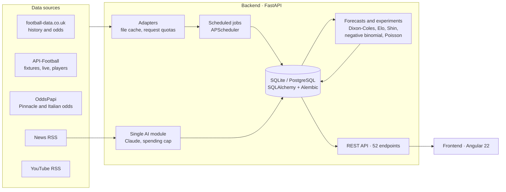

# ArchieBet

*Give me the odds, I'll move the world.*

[](https://github.com/giuseppecorso/archiebet/actions/workflows/ci.yml)


🇮🇹 [Versione italiana](README.md)

**A football forecasting and data-analysis platform.** It estimates the probability of every match outcome, compares
it with bookmaker prices and tests, with pre-registered statistical experiments, whether a model, a piece of
information or a strategy really beats a near-efficient betting market. AI (Claude) reads news and writes analyses,
but **every number is computed by code**.


> The user interface and the in-depth documents are in Italian; code, identifiers and commit messages are in English.

---

## At a glance

| | |
|---|---|
| **Problem** | Find out, with a sound method, whether and where a model or a piece of information beats a very efficient market |
| **Solution** | FastAPI backend with 6 data sources and statistical models (Dixon-Coles, Elo, Shin de-margining, negative binomial, in-play Poisson, Monte Carlo), Angular 22 frontend |
| **Method** | 137 documented decisions; every hypothesis tested with rules written before looking at the data, tuning and confirmation on separate periods, match-clustered standard errors |
| **Outcome** | One edge confirmed on historical data (CLV +2.5% ± 0.3 over 734 cases), now under live verification; dozens of hypotheses rejected and documented |
| **Quality** | 476 automated tests, GitHub Actions CI, Alembic migrations, one-command Docker start |

## Try it in 2 minutes (Docker)

```bash
git clone https://github.com/giuseppecorso/archiebet.git
cd archiebet
docker compose up --build
```

Open **http://localhost:8080** and log in with **demo / archiebet-demo**. Without API keys the app downloads the free
football-data.co.uk history (10 leagues, since 2023): statistics, match pages, Archie's forecasts, simulator.
Live odds, in-play data, news and AI are enabled by adding keys to `backend/.env` (see `.env.example`).

## Why it is interesting

- **Method before results.** A factor enters the model only if a test *written before looking at the data* shows it improves forecasts. Multi-hypothesis searches (e.g. 1,650 automatically generated strategies) use a stricter tuning threshold and confirmation on separate seasons, so that chance is not mistaken for a discovery.
- **Negative results reported.** Weather, rest days, coaching changes, line-ups, "style match-ups", automated strategies, lower leagues in 23 countries: they do not beat the market, and the numbers are in the [decision log](docs/DECISIONI.md).
- **The right metrics.** Probability calibration, paired log loss, **closing-line value** (taken price vs. fair closing price). Short-term profit is not a metric.
- **Full-stack engineering.** Data-source adapters with caching and request quotas, scheduled jobs, 52 REST endpoints, 25 tables, session authentication, AI with a spending cap enforced in code, signal-based frontend with lazy-loaded routes.

## Architecture



Main process in **BPMN 2.0** ([source](docs/bpmn/ciclo-previsione.bpmn), opens in [bpmn.io](https://demo.bpmn.io) or Camunda Modeler):


Details in the **[technical document](docs/DOCUMENTO-TECNICO.md)** (Italian).

## Stack

- **Backend:** Python 3.14, FastAPI, SQLAlchemy 2, Alembic, Pydantic, APScheduler, NumPy/SciPy, Anthropic SDK
- **Frontend:** Angular 22 (standalone components, signals, `httpResource`, lazy loading), TypeScript, SCSS, Vitest
- **Data:** SQLite locally (PostgreSQL-ready), per-source file cache
- **DevOps:** Docker and Docker Compose (nginx in front of the frontend), GitHub Actions (backend tests, frontend build and tests, image builds)

## How it was built

ArchieBet is a personal project (October 2026) built with a structured **AI-assisted workflow**: I acted as product
owner and technical reviewer, **[Claude Code](https://www.anthropic.com/claude-code)** (Anthropic) as the developer
implementing under explicit rules.

- **My part:** requirements and specifications, product decisions and priorities, non-negotiable statistical principles, approval of every decision, hands-on validation of the app, review of experiment results.
- **Rules given to the assistant** ([CLAUDE.md](CLAUDE.md)): every calculation has a test; no look-ahead data; a factor enters only if a historical test justifies it; numbers come from code, never from the AI; secrets only in `.env`; small, documented commits.
- **Checks:** 476 automated tests and CI on every push; every decision logged with its rationale; heavy experiments run on database copies; progress tracked phase by phase.
- **Commits** written with the assistant carry the `Co-Authored-By: Claude` trailer.

A goal of the project was also to learn how to lead AI-assisted development professionally: define the problem well,
set verifiable acceptance criteria, and never accept a result without tests and evidence.

## Disclaimer

Personal study project: not a tipping service and no betting advice. Gambling can be addictive; the app has
configurable spending limits and no feature rewards how much you bet. Photos from [Unsplash](https://unsplash.com/license);
ArchieTV videos are embedded from the leagues' official YouTube channels.
