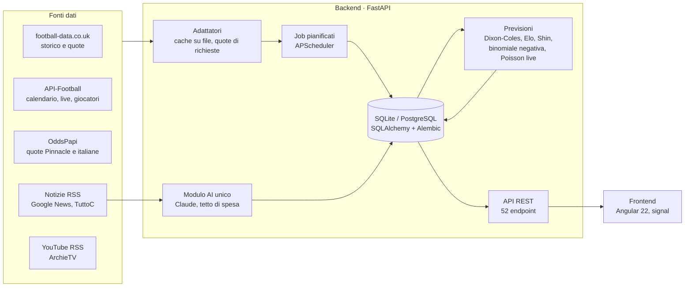

# ArchieBet

*Give me the odds, I'll move the world.*

[](https://github.com/giuseppecorso/archiebet/actions/workflows/ci.yml)


**Piattaforma personale di previsioni sul calcio e di analisi dei dati.** Stima la probabilità di ogni esito, la confronta con le quote dei bookmaker e misura, con metodi statistici verificabili, se un'informazione o una strategia batte davvero un mercato quasi efficiente. L'AI (Claude) legge notizie e scrive analisi, ma **i numeri li calcola sempre il codice**.

> **In English.** ArchieBet is a full-stack football forecasting and data-analysis platform (FastAPI + SQLAlchemy + Angular 22).
> It estimates match-outcome probabilities, compares them with bookmaker prices and tests, with pre-registered experiments,
> whether any model, factor or strategy beats a near-efficient betting market. Outcomes are judged on calibration and
> closing-line value (CLV), not short-term profit. 134 documented decisions, ~15k lines of Python, 450+ automated tests.

---

## Perché è interessante

- **Metodo prima dei risultati.** Ogni idea entra nel modello solo se una prova *scritta prima di guardare i dati* dimostra che migliora le previsioni: taratura su alcune stagioni, conferma su altre, errori standard per partita, soglie fissate in anticipo ([docs/DECISIONI.md](docs/DECISIONI.md), 134 decisioni con motivazione).
- **Risultati negativi dichiarati.** Meteo, riposo, cambio allenatore, formazioni, incastri di stile, 1.650 strategie generate in automatico, serie minori di 23 paesi: quasi tutto *non* batte il mercato, ed è scritto. L'unico vantaggio confermato (quote dei bookmaker italiani sopra la quota "giusta" di Pinnacle, regola D72) ha CLV +2,5% ± 0,3 su 734 casi storici ed è ora in verifica dal vivo.
- **Misure giuste.** Calibrazione delle probabilità, log loss appaiata, CLV (quota presa rispetto alla quota giusta di chiusura). Il guadagno di una settimana non conta.
- **Ingegneria completa.** Adattatori per 6 fonti dati con cache e quote di richieste, job pianificati, 15 migrazioni Alembic, 52 endpoint REST, 24 tabelle, autenticazione a sessione, AI con tetto di spesa nel codice, frontend Angular a signal con lazy loading.

## Funzioni

| Sezione | Cosa fa |
|---|---|
| **Home "Oggi"** | Partite di oggi, occasioni del momento, giocate in corso, ArchieTV (video ufficiali delle leghe dai feed RSS di YouTube) |
| **Partite** | Serie A, B, C, top 5 europei con seconde divisioni, coppe UEFA, 17 campionati dell'Est e del Nord; pagina partita con statistiche, formazioni previste, numeri attesi (tiri, angoli, cartellini), analisi scritta dall'AI, partite "gemelle" |
| **Live** | Risultati in diretta e quote giuste del momento dal punteggio e dal minuto (modello di Poisson verificato all'intervallo) |
| **Pronostici** | Stima migliore per ogni partita, Occasioni (valore rispetto a Pinnacle), generatore di multiple, Statistiche (campionati, squadre, "Cosa impara Archie"), simulatore Monte Carlo da 10.000 partite |
| **Il mio Archie** | Schedine reali e simulate chiuse in automatico, CLV, "sfortuna o errore?", regolamento personale, domande in linguaggio naturale ad Archie (Claude con strumenti sui dati dell'app) |
| **Schedina** | Sempre visibile: un clic su una quota la aggiunge, controllo del regolamento prima di registrare |

## Architettura



Il processo principale (dati → probabilità → occasioni → giocata → verifica del CLV → apprendimento settimanale) in BPMN 2.0:


Sorgente: [docs/bpmn/ciclo-previsione.bpmn](docs/bpmn/ciclo-previsione.bpmn) (si apre con [bpmn.io](https://demo.bpmn.io) o Camunda Modeler). Dettagli tecnici nel [documento tecnico](docs/DOCUMENTO-TECNICO.md).

## Stack

- **Backend:** Python 3.12, FastAPI, SQLAlchemy 2, Alembic, Pydantic, APScheduler, NumPy/SciPy, SDK Anthropic
- **Frontend:** Angular 22 (standalone, signal, `httpResource`, lazy loading), TypeScript, SCSS, Vitest
- **Dati:** SQLite in locale (pronto per PostgreSQL), cache su file per ogni fonte
- **Qualità:** pytest (420 test), Vitest (28 test), GitHub Actions

## Avvio rapido

Servono Python 3.12+ e Node.js 22+.

```bash
# Backend
cd backend
python -m venv .venv
.venv/Scripts/python -m pip install -e ".[dev]"     # su Linux/macOS: .venv/bin/python
copy .env.example .env                               # e inserisci le chiavi delle fonti dati che usi
.venv/Scripts/alembic upgrade head
.venv/Scripts/python -m app.cli create-user demo --admin
.venv/Scripts/uvicorn app.main:app --port 8000

# Frontend (secondo terminale)
cd frontend
npm install
npm start                                            # http://localhost:4280
```

Su Windows, dopo la prima installazione, basta `riavvia-archiebet.bat`: applica le migrazioni, avvia (o riavvia) backend e frontend e apre il browser.

Test: `cd backend && .venv/Scripts/python -m pytest -q` e `cd frontend && npx ng test --watch=false`.

Le chiavi delle fonti dati (API-Football, OddsPapi, Anthropic) vanno solo nel file `.env`, che non è nel repository. Senza chiavi l'app funziona con i dati storici gratuiti di football-data.co.uk.

## Documentazione

| Documento | Contenuto |
|---|---|
| [Documento tecnico](docs/DOCUMENTO-TECNICO.md) | Architettura, modello dei dati, modelli statistici, metodo delle prove, test, scelte e limiti |
| [Processo BPMN](docs/bpmn/ciclo-previsione.bpmn) | Ciclo di una previsione, dai dati al verdetto |
| [Decisioni](docs/DECISIONI.md) | 134 decisioni con motivazione, comprese le prove fallite |
| [Specifiche](docs/SPECIFICHE.md) | Requisiti, principi, fasi del progetto |
| [Stato](docs/STATO.md) | Avanzamento fase per fase |

## Come è stato sviluppato

Progetto personale, ottobre 2026, sviluppato con **Claude Code come pair programmer**: requisiti, scelte di prodotto e verifica sono miei, buona parte del codice è scritta con l'assistente e rivista. Il file [CLAUDE.md](CLAUDE.md) contiene le regole di lavoro date all'assistente (principi statistici, test obbligatori per ogni calcolo, niente segreti su Git).

## Avvertenze

Uso privato e a scopo di studio: non è un servizio di pronostici e non contiene consigli di gioco. Il gioco d'azzardo può creare dipendenza; l'app ha limiti di spesa impostabili e nessuna funzione premia quanto si gioca. Le foto sono di [Unsplash](https://unsplash.com/license).
