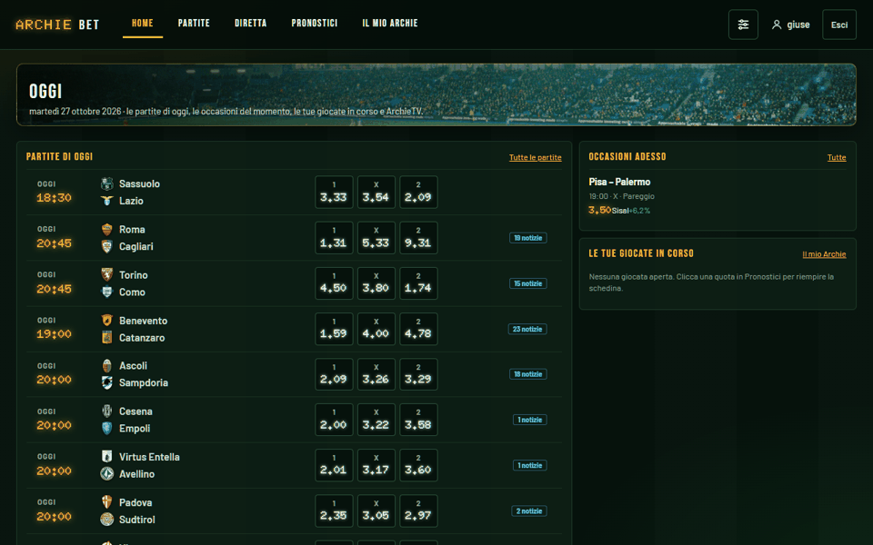
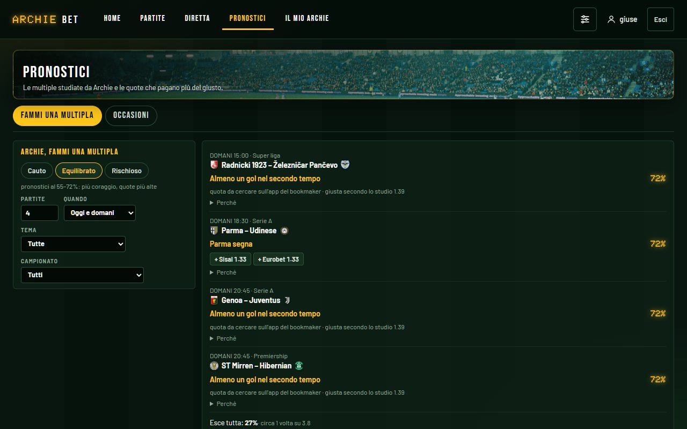
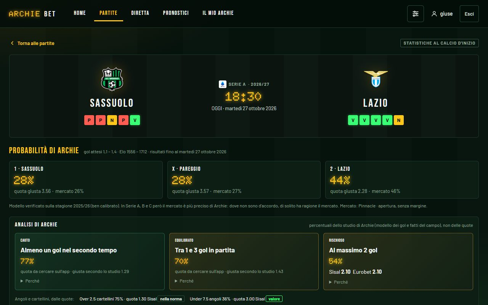
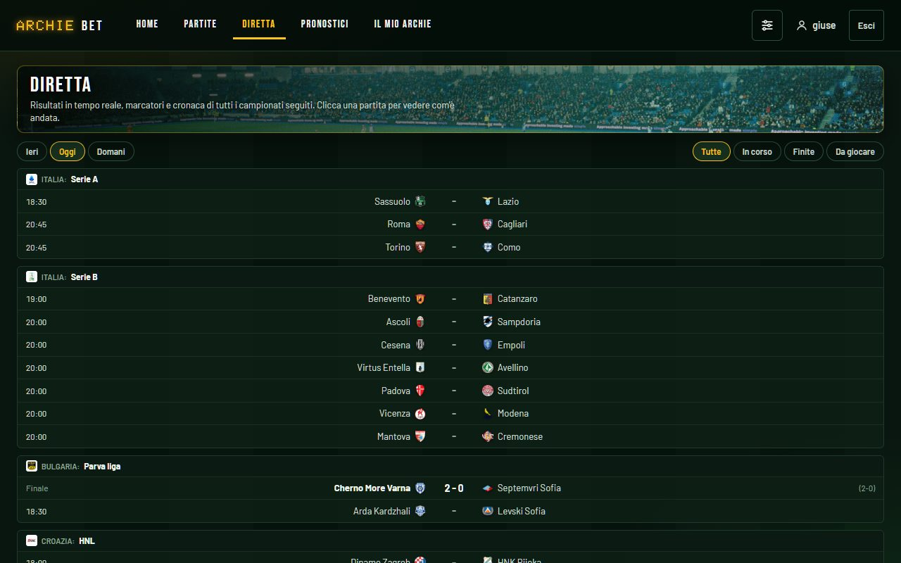
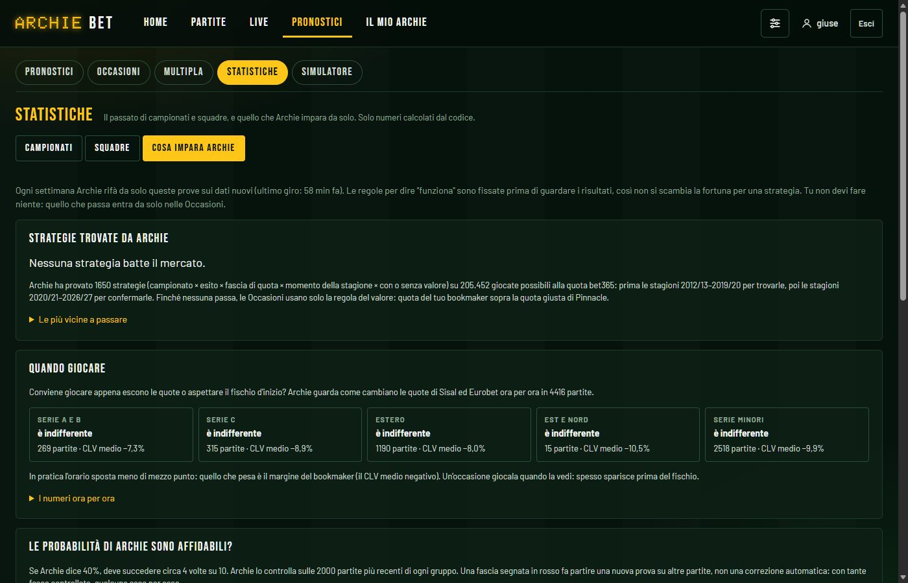
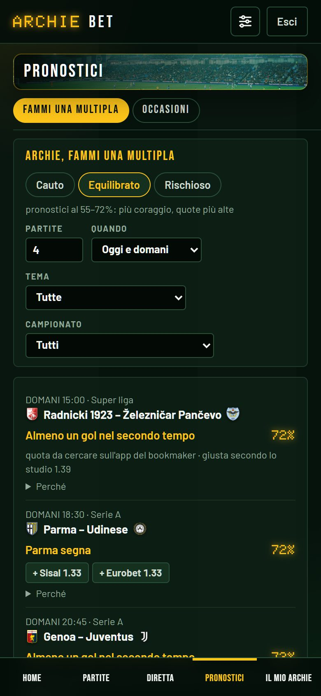
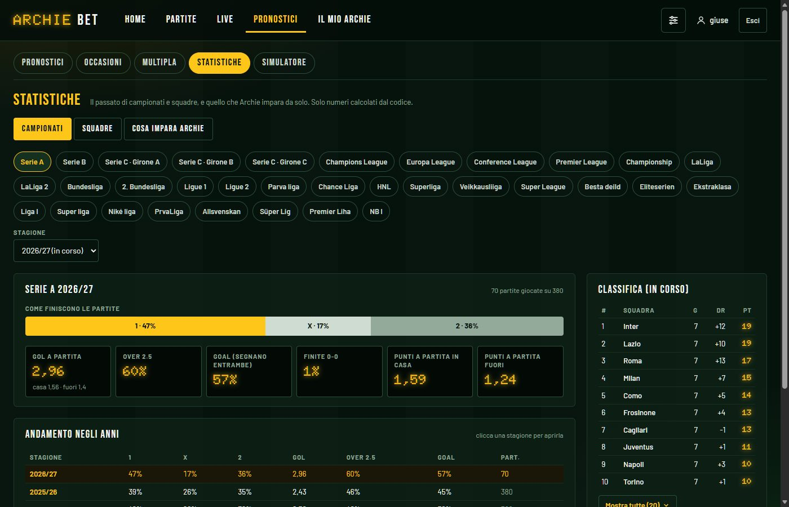
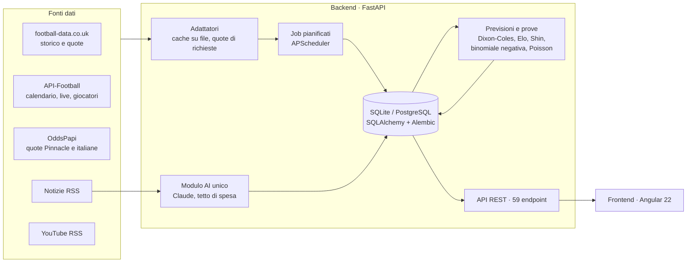
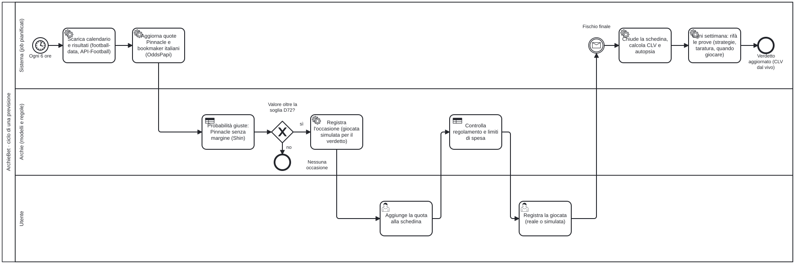

# ArchieBet

*Give me the odds, I'll move the world.*

[](https://github.com/giuseppecorso/archiebet/actions/workflows/ci.yml)


🇬🇧 [English version](README.en.md)

**Piattaforma di previsioni sul calcio e di analisi dei dati.** Stima la probabilità di ogni esito, la confronta con le
quote dei bookmaker e verifica, con prove statistiche pre-registrate, se un modello, un'informazione o una strategia
batte davvero un mercato quasi efficiente. L'AI (Claude) legge notizie e scrive analisi, ma **i numeri li calcola
sempre il codice**.



---

## In breve

| | |
|---|---|
| **Problema** | Capire, con metodo, se e dove un modello o un'informazione batte le quote di un mercato molto efficiente |
| **Soluzione** | Backend FastAPI con 6 fonti dati, modelli statistici (Dixon-Coles, Elo, Shin, binomiale negativa, Poisson live, Monte Carlo), frontend Angular 22 |
| **Metodo** | 164 decisioni documentate; ogni ipotesi provata con regole scritte prima di vedere i dati, taratura e conferma su periodi separati, errori standard per partita |
| **Risultato** | Previsioni migliorate partendo dal prezzo del mercato (D163, verificato su una stagione mai vista); un vantaggio confermato sullo storico (CLV +2,5% ± 0,3 su 734 casi), in verifica dal vivo; decine di ipotesi scartate e documentate |
| **Qualità** | 589 test automatici, CI su GitHub Actions, migrazioni Alembic, avvio con Docker in un comando |

## Provalo in 2 minuti (Docker)

```bash
git clone https://github.com/giuseppecorso/archiebet.git
cd archiebet
docker compose up --build
```

Apri **http://localhost:8080** ed entra con **demo / archiebet-demo**. Senza chiavi API l'app scarica lo storico
gratuito di football-data.co.uk (10 campionati, dal 2023): statistiche, pagine partita, previsioni di Archie,
simulatore e **Fammi una multipla** sulle partite in programma. Quote attuali, Diretta, notizie e AI si attivano
aggiungendo le chiavi in `backend/.env` (vedi `.env.example`). Non c'è una demo online di proposito: l'app è a uso
privato e non pubblica pronostici né quote su pagine aperte a tutti.

## Perché è interessante

- **Metodo prima dei risultati.** Un fattore entra nel modello solo se una prova *scritta prima di guardare i dati* dimostra che migliora le previsioni. Le prove con molte ipotesi (es. 1.650 strategie generate in automatico) usano una soglia più severa in taratura e una conferma su stagioni separate, per non scambiare il caso per una scoperta.
- **Risultati negativi dichiarati.** Meteo, riposo, cambio allenatore, formazioni, "incastri di stile", strategie automatiche, serie minori di 23 paesi: non battono il mercato, ed è scritto nel [registro delle decisioni](docs/DECISIONI.md) con i numeri.
- **Misure corrette.** Calibrazione delle probabilità, log loss appaiata, **CLV** (quota presa rispetto alla quota giusta di chiusura). I soldi vinti in una settimana non sono una misura.
- **Ingegneria completa.** Adattatori con cache e quote di richieste, job pianificati, 59 endpoint REST, 26 tabelle, autenticazione a sessione, AI con tetto di spesa controllato dal codice, frontend a signal con caricamento pigro delle pagine.

## Schermate

| Fammi una multipla | Pagina partita |
|---|---|
|  |  |
| **Diretta** | **Cosa impara Archie** |
|  |  |
| **Sul telefono (app installabile)** | **Statistiche dei campionati** |
|  |  |

## Funzioni

| Sezione | Cosa fa |
|---|---|
| **Home "Oggi"** | Partite di oggi, occasioni del momento, giocate in corso, ArchieTV (video ufficiali delle leghe dai feed RSS di YouTube) |
| **Partite** | Un giorno alla volta con tendine per giorno e campionato, campionati principali in testa; marcatori nelle partite finite, notizie del tifoso per partita e ordine "più notizie"; pagina partita con statistiche, formazioni previste, cronaca, numeri attesi, analisi scritta dall'AI |
| **Diretta** | Risultati in tempo reale come su un sito di risultati: minuto, punteggio, primo tempo e cronaca (gol con assist, rigori, autogol, cartellini, cambi, VAR) da API-Football |
| **Pronostici** | **Fammi una multipla**: pronostici studiati da Archie (modello dei gol Dixon-Coles con primo tempo, fatti del campo, notizie, classifica e meteo) in tre livelli (cauto, equilibrato, rischioso), quante partite si vuole, ognuno con il suo perché e "genera un'altra multipla"; **Occasioni**: le quote che pagano più del giusto (regola provata su 5 stagioni) |
| **Il mio Archie** | Schedine reali e simulate chiuse in automatico, CLV, "sfortuna o errore?", regolamento personale, domande in linguaggio naturale (Claude con strumenti sui dati dell'app) |
| **Schedina** | Sempre visibile: un clic su una quota la aggiunge; controllo del regolamento prima di registrare |

## Architettura



Il processo principale in **BPMN 2.0** (sorgente: [docs/bpmn/ciclo-previsione.bpmn](docs/bpmn/ciclo-previsione.bpmn), si apre con [bpmn.io](https://demo.bpmn.io) o Camunda Modeler):




Dettagli nel **[documento tecnico](docs/DOCUMENTO-TECNICO.md)**: architettura, modello dei dati, modelli statistici, metodo delle prove, qualità, limiti.

## Stack

- **Backend:** Python 3.14, FastAPI, SQLAlchemy 2, Alembic, Pydantic, APScheduler, NumPy/SciPy, SDK Anthropic
- **Frontend:** Angular 22 (componenti standalone, signal, `httpResource`, lazy loading), TypeScript, SCSS, Vitest
- **Dati:** SQLite in locale (pronto per PostgreSQL), cache su file per ogni fonte
- **DevOps:** Docker e Docker Compose (nginx davanti al frontend), GitHub Actions (test backend, build e test frontend, build delle immagini)

## Sviluppo locale (senza Docker)

Servono Python 3.12+ e Node.js 22+.

```bash
cd backend
python -m venv .venv
.venv/Scripts/python -m pip install -e ".[dev]"     # Linux/macOS: .venv/bin/python
copy .env.example .env                               # chiavi delle fonti dati facoltative
.venv/Scripts/alembic upgrade head
.venv/Scripts/python -m app.cli create-user tuonome --admin
.venv/Scripts/uvicorn app.main:app --port 8000

cd ../frontend
npm install
npm start                                            # http://localhost:4280
```

Test: `cd backend && .venv/Scripts/python -m pytest -q` · `cd frontend && npx ng test --watch=false`.
Su Windows `riavvia-archiebet.bat` applica le migrazioni e avvia (o riavvia) backend e frontend.

## Come è stato sviluppato

ArchieBet è un progetto personale (ottobre 2026) realizzato con un **flusso di lavoro AI-assisted** strutturato:
io nel ruolo di product owner e revisore tecnico, **[Claude Code](https://www.anthropic.com/claude-code)** (Anthropic) nel ruolo di
sviluppatore che implementa sotto regole precise.

- **Cosa ho fatto io:** requisiti e specifiche ([SPECIFICHE.md](docs/SPECIFICHE.md)), scelte di prodotto e priorità, principi statistici non negoziabili, approvazione delle decisioni, verifica dell'app in uso, revisione dei risultati delle prove.
- **Regole date all'assistente** ([CLAUDE.md](CLAUDE.md)): ogni calcolo ha un test; niente dati dal futuro; un fattore entra solo se una prova sul passato lo giustifica; i numeri li calcola il codice, mai l'AI; chiavi solo in `.env`; commit piccoli e documentati.
- **Controlli:** 589 test automatici e CI a ogni push; ogni decisione registrata con motivazione ([DECISIONI.md](docs/DECISIONI.md)); prove pesanti eseguite su copie del database; avanzamento tracciato fase per fase ([STATO.md](docs/STATO.md)).
- **Commit:** quelli scritti con l'assistente riportano il trailer `Co-Authored-By: Claude`.

L'obiettivo era anche imparare a guidare in modo professionale uno sviluppo assistito dall'AI: definire bene il problema, fissare criteri di accettazione verificabili e non accettare un risultato senza test e senza prove.

## Avvertenze

Progetto personale a scopo di studio: non è un servizio di pronostici e non contiene consigli di gioco. Il gioco
d'azzardo può creare dipendenza; l'app ha limiti di spesa impostabili e nessuna funzione premia quanto si gioca.
Le foto sono di [Unsplash](https://unsplash.com/license); i video di ArchieTV sono incorporati dai canali YouTube ufficiali delle leghe.
