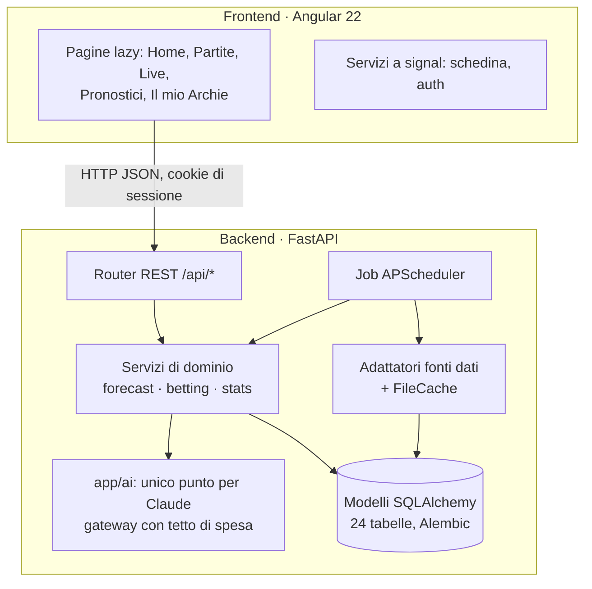

# ArchieBet — Documento tecnico

Versione 1.1 · ottobre 2026 · autore: Giuseppe Corso

Questo documento descrive architettura, dati, modelli statistici, metodo di verifica e qualità del software di ArchieBet.
Le motivazioni di ogni scelta sono nel registro delle decisioni ([DECISIONI.md](DECISIONI.md)), citato come `Dnn`.

---

## 1. Obiettivo e principi

ArchieBet stima la probabilità degli esiti delle partite di calcio e la confronta con le quote dei bookmaker. Il problema
tecnico interessante non è "fare pronostici" ma **verificare in modo onesto se un'informazione batte un mercato quasi
efficiente**. Da qui otto principi non negoziabili, che guidano il codice:

1. **Valore, non pronostici:** valore = probabilità × quota − 1.
2. **Si giudica su calibrazione e CLV** (closing line value), non sui soldi vinti nel breve.
3. **Niente dati dal futuro:** validazione walk-forward; una stagione intera (2025/26) è rimasta "in cassaforte" fino al verdetto (D58).
4. **I numeri li calcola il codice, mai l'AI.** L'AI legge testi e spiega numeri già calcolati.
5. **Un fattore entra nel modello solo se una prova sul passato dimostra che migliora le previsioni.**
6. **Uso privato:** nessuna pagina pubblica con pronostici o quote.
7. **Gioco responsabile:** limiti impostabili, nessuna funzione premia quanto si gioca.
8. **Scalabilità di base:** dati legati a `user_id`, calcoli per partita salvati una volta, un modulo per fonte e uno solo per l'AI.

## 2. Architettura

**Struttura del backend** (`backend/app`):

| Cartella | Responsabilità |
|---|---|
| `adapters/` | Un modulo per fonte: football-data, API-Football, OddsPapi, notizie RSS, YouTube. Cache su file per richiesta, limiti e riserve di richieste, registro dei consumi (`usage_events`) |
| `ingest/` | Trasforma le risposte delle fonti in righe del database: squadre (anagrafica unica con alias per fonte), partite, quote, statistiche, notizie |
| `forecast/` | Modelli e prove: Dixon-Coles, Elo, rimozione del margine, radar delle occasioni, modelli dei conteggi, live, simulatore, ricerca delle strategie, quando giocare |
| `betting/` | Schedine, chiusura automatica, CLV, autopsie, regolamento personale |
| `ai/` | Client Claude con output strutturato (Pydantic), strumenti per "Chiedi ad Archie", estrazione di fatti dalle notizie |
| `api/` | 53 endpoint REST divisi per area |
| `jobs.py` | Aggiornamento dati ogni 6 ore, live ogni minuto, notizie ogni 2 ore, archivio quote e "cosa impara Archie" ogni settimana |
| `cli.py` | Comandi per sincronizzazioni e per le prove statistiche (`backtest`, `strategy-search`, `timing-test`, ...) |

**Frontend** (`frontend/src/app`): componenti standalone, stato con signal, dati con `httpResource`, rotte lazy
(pagine scaricate solo quando servono), un servizio `SlipService` per la schedina sempre visibile (salvata nel browser).

## 3. Dati

| Fonte | Uso | Costo e limiti |
|---|---|---|
| football-data.co.uk | Storico 2005–oggi di 10 campionati con quote d'apertura e chiusura (Pinnacle fino a metà 2025/26) | Gratuito |
| API-Football (piano Pro) | Calendario, risultati, live ogni minuto, formazioni, statistiche dei giocatori; Serie C, coppe, Est e Nord Europa | 7.500 richieste/giorno |
| OddsPapi | Quote attuali e storia minuto per minuto di Pinnacle e 9 bookmaker italiani | 250 richieste/mese; lo storico non si conta |
| Google News, TuttoC (RSS) | Notizie su infortuni, squalifiche, allenatori | Gratuito, pausa tra le ricerche |
| YouTube (RSS) | ArchieTV, video ufficiali delle leghe | Gratuito |
| Claude API | Fatti dalle notizie (Haiku), giudizi, analisi e domande (Opus) | Tetto di 10 €/mese nel codice |

Ogni adattatore passa da `FileCache`: una risposta per file JSON con data di salvataggio, così le prove si ripetono
offline e le quote di richieste non si sprecano. Le partite di fonti diverse si collegano per campionato, squadre
(nomi normalizzati con regole e alias) e data con tolleranza.

**Modello dei dati (estratto):** `competitions`, `teams` + `team_aliases`, `matches` + `match_sources`, `match_odds`
(per fonte, bookmaker, mercato, esito, apertura/chiusura), `match_live`, `match_predictions`, `radar_signals`,
`bets` + `bet_selections` + `bet_snapshots`, `news_items`, `team_facts`, `match_insights`, `usage_events`, `users` + `user_sessions`, `user_settings`, `user_rules`.

## 4. Modelli statistici

| Modello | Dove | Note |
|---|---|---|
| **Dixon-Coles + Elo** | `forecast/dixon_coles.py`, `elo.py` | Gol attesi per squadra con correzione dei punteggi bassi e decadimento nel tempo; walk-forward |
| **Rimozione del margine** | `forecast/demargin.py` | Proporzionale, potenza, additivo, odds ratio, **Shin** (scelto con una prova sulla log loss, D73) |
| **Radar delle occasioni** | `forecast/radar.py` | Valore = p(Pinnacle, Shin) × quota italiana − 1; soglia 2%·√(quota−1), minimo 1,5%, quota ≤ 4 (D72) |
| **Conteggi** (tiri, angoli, cartellini) | `forecast/counts.py` | "Fatti × subiti" con restringimento verso la media e binomiale negativa (D108-D109) |
| **Tiri dei giocatori** | `forecast/player_props.py` | Tasso per minuto ristretto alla media del ruolo × minuti attesi × avversario; calibrato su 22.800 presenze (D110) |
| **Live** | `forecast/live.py` | Gol attesi dalle probabilità pre-partita, Poisson per squadra, 45% dei gol nel primo tempo; verificato all'intervallo (D92) |
| **Simulatore** | `forecast/simulator.py` | Monte Carlo da 10.000 partite e "E se..." da qualunque minuto e punteggio |
| **Multipla** | `forecast/multiple.py` | Ricerca combinatoria con limite adattivo; 5 livelli di rischio e profilo personalizzato; fasce dichiarate "valore / nella norma / paga poco"; "1 volta su N" verificato sullo storico (D130) |

## 5. Metodo delle prove

Ogni prova segue lo stesso schema, scritto nel registro **prima** di guardare i risultati:

1. **Ipotesi e misura** (es. log loss appaiata, CLV con errore standard raggruppato per partita).
2. **Divisione dei dati**: taratura su alcune stagioni, conferma su altre (o per data a metà dell'archivio).
3. **Soglia**: di solito un miglioramento oltre 2 errori standard in taratura *e* in conferma; per le ricerche su molte ipotesi una soglia più severa in taratura (t ≥ 3) per tenere bassi i falsi positivi.
4. **Esito applicato senza ritocchi**, anche se negativo.

**Risultati principali**

| Prova | Esito |
|---|---|
| Modello Dixon-Coles contro il mercato (D58-D59) | Calibrato, ma il mercato di chiusura è più preciso: le probabilità mostrate vengono dal mercato |
| Occasioni D72 su 5 stagioni (D86-D87) | **Confermate:** 734 occasioni, CLV +2,5% ± 0,3 alla quota bet365 d'apertura |
| Meteo, riposo, allenatore, campo sintetico, assenze (D81, D89, D91) | Nessuno migliora il mercato |
| Notizie lette dall'AI (D101-D105) | In corso: verdetto a 150 partite (spostamento delle quote verso il giudizio) |
| Incastri di stile (D108) | Nessun guadagno su 54.000 partite |
| Archie cerca 1.650 strategie (D118) | Nessuna passa la conferma |
| Quando giocare (D119) | Indifferente: l'orario sposta meno di mezzo punto di CLV, il margine pesa 7–10% |
| Formazioni previste (D123) | "L'ultima formazione" indovina più del metodo pesato: 8,5 titolari su 11 |
| Serie minori di 23 paesi (D106) | Non passano: le occasioni hanno CLV negativo |

## 6. AI

Un solo modulo (`app/ai`) parla con Claude, sempre con **output strutturato** (schemi Pydantic) e con un **gateway di
spesa** che registra ogni chiamata e blocca oltre il tetto mensile. Usi:

- **Estrazione** di fatti dalle notizie (Haiku 5.5): squadra, giocatore, tipo (assenza, rientro, allenatore...), dettaglio.
- **Giudizio** sulla partita e **analisi scritta** (Opus 5.5) su una scheda preparata dal codice: l'AI usa solo i numeri forniti.
- **Chiedi ad Archie**: ciclo di strumenti (`cerca_partite`, `scheda_partita`, `occasioni`, `notizie_squadra`, `le_mie_giocate`) per rispondere in italiano sui dati dell'app.

## 7. Qualità

- **442 test backend** (pytest) e **29 test frontend** (Vitest): ogni calcolo di probabilità, quota, valore o guadagno ha un test (anche casi limite trovati a mano, es. arrotondamenti).
- **Test delle API** con database in memoria e client autenticato; adattatori provati con risposte registrate, senza rete.
- **CI** su GitHub Actions a ogni push (`.github/workflows/ci.yml`): test del backend, build e test del frontend, build delle immagini Docker.
- **Docker**: `docker compose up --build` avvia backend (FastAPI) e frontend (build Angular servita da nginx, che inoltra `/api`), con un utente dimostrativo e lo storico gratuito di football-data, senza chiavi API.
- **Migrazioni** Alembic per ogni cambio di schema; prove pesanti eseguite su una copia del database.
- **Segreti** solo in `.env` (escluso da Git); nessun dato delle fonti nel repository.

## 8. Limiti e sviluppi

- Il vantaggio misurato è piccolo e raro (~50 occasioni a stagione su 10 campionati alla quota bet365): il verdetto dal vivo è lento. Prossimo passo proposto: verdetto sequenziale e più bookmaker giocabili.
- Dipendenza da fonti esterne con quote di richieste (OddsPapi 250/mese).
- App pensata per un utente su un PC; il passaggio a PostgreSQL e a un server è previsto dalla struttura (sezione 14 delle specifiche) ma non fatto.
- Le strategie e la taratura si rimisurano ogni settimana da sole (lavoro "learning").
